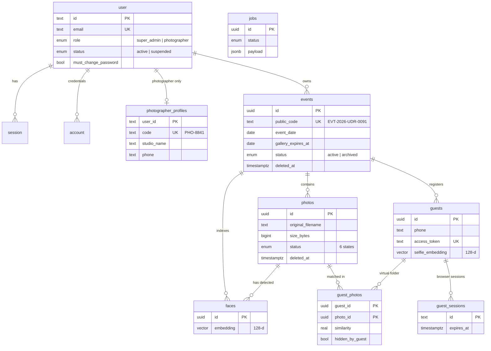

# InstantPhotos: Database

Everything about the database in one place: what it is, how the tables relate, which screen reads which table, and how to run it.

Source of truth for scope is [PRD.md](PRD.md) (§8 data model, §9 storage, §10 matching). The schema itself is code: `packages/db/src/schema/`. If this file and the code disagree, the code wins; fix this file.

**Status (29 Oct 2026):** the app runs on this database. The Super Admin area (login, photographers, events, usage, guest search and delete, change password) reads and writes Postgres through `packages/core`, with login and sessions handled by Better Auth. Migrated and seeded on a personal **Neon** dev database. See [section 10](#10-whats-wired-and-whats-not).

---

## 1. At a glance

| | |
|---|---|
| Database | PostgreSQL 15+ with the **pgvector** extension |
| Hosted | **Neon** (personal account), currently a dev database |
| Local development | Own Postgres 16 cluster in `.local/postgres`, port 5433 (git-ignored) |
| ORM and migrations | **Drizzle** (`drizzle-orm`, `drizzle-kit`), driver `pg` |
| Auth | **Better Auth** 1.7 (`user`, `session`, `account`, `verification`); email + password, no sign-up |
| Images | Never in the database. They live in Cloudflare R2; the database stores only the object keys |
| Tables | 13 (4 auth, 9 application) |

---

## 2. Where things live

```
packages/db/
  src/
    schema/auth.ts      Better Auth tables + user role/status enums
    schema/app.ts       application tables, enums, indexes
    schema/index.ts     re-exports both
    client.ts           createDb() for scripts, getDb() shared pool for the server (snake_case columns)
    admin-user.ts       ensureSuperAdmin(): creates or updates the admin from env, password hashed
    create-admin.ts     `npm run db:create-admin`: only the admin, touches no other data
    migrate.ts          applies migrations/
    seed.ts             wipes and fills the dummy data + the admin (refuses in production)
    seed-data.ts        the dummy people, events and guests
    index.ts            what other packages import
  migrations/           generated SQL (0000_*.sql) + drizzle meta. Commit these.
  drizzle.config.ts     drizzle-kit settings
  scripts/local-db.sh   start/stop/destroy the local database
.env.example            DATABASE_URL template (copy to .env.local)
```

Who uses it:
- `packages/core` (business logic) calls `getDb()` and runs every query. API routes in `apps/web/src/server/api.ts` only call core.
- `apps/web/src/server/auth.ts` configures Better Auth on the same database. Its HTTP handler is **not** mounted; login, logout and change-password go through our own routes.
- Environment lives in one file, the repo-root `.env.local` (`next.config.ts` loads it for the web app).

Naming: TypeScript uses camelCase (`galleryExpiresAt`), the database uses snake_case (`gallery_expires_at`). Drizzle converts automatically (`casing: "snake_case"`).

---

## 3. Entity relationships



Reading the diagram:
- A **photographer** is a `user` with `role = photographer` plus one row in `photographer_profiles`.
- The **Super Admin** is a `user` with `role = super_admin` and no profile.
- An **event** belongs to one photographer. Photos, guests and faces belong to one event.
- A **match** is a row in `guest_photos` (guest + photo + similarity). Photos are never copied per guest (D10).
- `jobs` has no foreign keys. Each job's `payload` names the photo it is for.

---

## 4. Tables

Types: `text`, `uuid`, `date`, `timestamptz` (all timestamps carry a time zone), `vector(128)` (pgvector).
"Live" means `deleted_at IS NULL` (see [section 6](#6-soft-delete)).

### 4.1 Authentication (Better Auth shape)

**`user`**
| Column | Type | Notes |
|---|---|---|
| id | text PK | Better Auth generates it |
| name | text | display name |
| email | text, unique | login identifier (lower case) |
| email_verified | bool | default false |
| image | text | unused |
| role | enum `super_admin` / `photographer` | default `photographer`. Drives every access rule (AUTH-9..11) |
| status | enum `active` / `suspended` | suspended photographers cannot log in |
| must_change_password | bool | true after the admin sets a temporary password |
| created_at, updated_at | timestamptz | |

**`account`**: one row per login method. For email/password, `provider_id = "credential"` and `password` holds the **hash**, never the plain text. Also has OAuth token columns Better Auth expects (unused here). FK `user_id` → `user` (cascade delete).

**`session`**: `id`, `user_id` (cascade), `token` (unique), `expires_at`, `ip_address`, `user_agent`, timestamps.

**`verification`**: `identifier`, `value`, `expires_at`. Used by Better Auth for email flows; empty in beta.

### 4.2 Application

**`photographer_profiles`** (one per photographer; PK is `user_id`, cascade delete)
| Column | Notes |
|---|---|
| code | unique, shown to the admin, format `PHO-8841` |
| studio_name | required; printed at the top of the QR card |
| display_name, website, instagram | optional |
| phone | required, stored formatted `+91 98201 44521` |
| logo_key, brand_image_key | R2 keys, optional |
| updated_at | |

**`events`**
| Column | Notes |
|---|---|
| id | uuid PK |
| photographer_id | FK → `user`; index |
| name, venue | venue defaults to empty string |
| event_date | `date` |
| public_code | unique, `EVT-2026-UDR-0091`; goes in the QR link |
| status | `active` / `archived` |
| gallery_expires_at | `date`: the last day guests can view. Default is `event_date + 7 days` (D11) |
| created_at, updated_at | |
| deleted_at, deleted_by | soft delete; `deleted_by` → `user` |

**`photos`**
| Column | Notes |
|---|---|
| id | uuid PK |
| event_id | FK → `events` |
| original_key | R2 key; required. `web_key` and `thumb_key` are filled when processing finishes |
| original_filename, size_bytes | together with `event_id` they are **unique**, so re-uploading the same file is skipped |
| width, height, taken_at | `taken_at` is the EXIF capture time and orders the gallery |
| status | `pending_upload` → `uploaded` → `processing` → `ready`; or `upload_failed` / `failed` |
| fail_reason, face_count, uploaded_at | |
| created_at, deleted_at | |

Who sets `status`: the app sets `pending_upload`, `upload_failed` and `uploaded`; the face worker sets `processing`, `ready` and `failed`.

**`faces`**: one row per detected face. `photo_id`, `event_id`, `embedding vector(128)`, `bbox jsonb`, `det_score`, `deleted_at`. Empty until the worker exists.

**`guests`**
| Column | Notes |
|---|---|
| id | uuid PK |
| event_id | FK → `events` |
| name, phone | `(event_id, phone)` is **unique**: one registration per phone per event |
| selfie_key | R2 key of the selfie |
| selfie_embedding | `vector(128)`, used for matching |
| access_token | unique; the private gallery link contains it |
| consent_at | when the guest ticked consent |
| created_at, updated_at, deleted_at | |

**`guest_photos`**: PK `(guest_id, photo_id)`. `similarity` (real), `hidden_by_guest` (bool), `matched_at`, `deleted_at`. This is the guest's "virtual folder".

**`guest_sessions`**: `id` (random text, stored in the guest's httpOnly cookie), `guest_id` (cascade), `expires_at`, `ip`, `user_agent`.

**`login_attempts`**: failed-login counter per client IP (`key` PK, `count`, `reset_at`). 5 failures within 15 minutes blocks that IP (AUTH-8). In the database, not memory, so it works across server instances. A successful login clears the row.

**`jobs`**: the queue for the face worker (PRD D9). `type` (default `process_photo`), `payload jsonb`, `status` (`pending` / `running` / `done` / `failed`), `attempts`, `last_error`, `run_after`, `locked_at`. The worker picks work with `FOR UPDATE SKIP LOCKED`.

---

## 5. Indexes and constraints

| Where | What | Why |
|---|---|---|
| `user.email` | unique | login lookup |
| `photographer_profiles.code`, `events.public_code`, `guests.access_token`, `session.token` | unique | public identifiers and tokens |
| `events(photographer_id)` | index | photographer's event list |
| `events(deleted_at)` | index | live-event filter |
| `photos(event_id, original_filename, size_bytes)` | unique | upload de-duplication |
| `photos(event_id, status)` | index | progress counts, "still processing" |
| `faces(event_id)`, `faces(photo_id)` | index | matching is filtered by event |
| `guests(event_id, phone)` | unique | one registration per phone per event |
| `guests(phone)` | index | Super Admin phone search (ADM-7) |
| `guest_photos(guest_id)` | index | load one guest's gallery |
| `jobs(status, run_after)` | index | worker polling |

What counts as a photo in the admin numbers: status `uploaded`, `processing`, `ready` or `failed`. `pending_upload` and `upload_failed` never reached the server, so they are not counted.

Matching: for beta, exact cosine search over `faces` filtered by `event_id` (about 15,000 faces per event is fast and always correct). Add an HNSW index later only if events grow much larger.

Foreign keys on `events`, `photos`, `faces`, `guests`, `guest_photos` have **no cascade**: rows are soft-deleted, never removed. Cascades exist only on auth/session rows.

---

## 6. Soft delete

`deleted_at IS NULL` means live. Deleting an event or a photo sets `deleted_at` on the row **and all its dependants in one transaction**. No database rows and no R2 objects are removed.

- Every query that shows data to photographers or guests, every signed-URL generator and every matching search **must** filter on `deleted_at IS NULL`.
- **Exception:** the Super Admin's usage and storage numbers (ADM-1, ADM-6, decision D26) **do not filter**, so deleted events still count. The seed includes two deleted events (800 photos, 6.7 GB) to exercise this.

---

## 7. Storage mapping (database ↔ Cloudflare R2)

The database holds keys; the bytes are in one private R2 bucket (PRD §9).

| Database column | R2 key pattern |
|---|---|
| `photos.original_key` | `events/{eventId}/originals/{photoId}.jpg` |
| `photos.web_key` | `events/{eventId}/web/{photoId}.jpg` |
| `photos.thumb_key` | `events/{eventId}/thumbs/{photoId}.jpg` |
| `guests.selfie_key` | `events/{eventId}/selfies/{guestId}.jpg` |
| `photographer_profiles.logo_key` | `photographers/{userId}/branding/logo.{ext}` |
| `photographer_profiles.brand_image_key` | `photographers/{userId}/branding/brand.{ext}` |

Access is always through per-image signed URLs (1 hour for guests). The seed writes realistic keys but no objects exist in R2.

---

## 8. Which screen reads what

| Screen | Needs | Tables | Notes |
|---|---|---|---|
| Admin: Photographers | list with event, photo, guest, storage totals | `user`, `photographer_profiles`, `events`, `photos`, `guests` | Totals include soft-deleted events |
| Admin: Photographers (create, suspend, reset password) | write | `user`, `account`, `photographer_profiles` | Temporary password goes in `account.password` as a hash; sets `must_change_password` |
| Admin: Events | live events with studio name, photo and guest counts | `events`, `photographer_profiles`, `photos`, `guests` | Filter `events.deleted_at IS NULL` |
| Admin: Usage | totals, per-photographer rows, "included deleted" | all of the above | **No** soft-delete filter |
| Admin: guest search and delete | search by phone, delete a guest's data | `guests`, `events`, `guest_photos`, `guest_sessions` | Search needs at least 4 digits. Delete **removes the rows** (guest, matches, sessions), which is deliberate for privacy (ADM-7). The selfie file in R2 is removed once storage is connected |
| Admin: Account | change password | `account`, `session` | Changing it revokes the user's other sessions; this one gets a fresh session |
| Login | email + password | `user`, `account`, `session`, `login_attempts` | Done. Replaced the config file. Suspended accounts are refused and their sessions deleted |
| Photographer (later) | events, photos, guests, QR, branding | `events`, `photos`, `guests`, `guest_photos`, `photographer_profiles` | Always scoped by `photographer_id` |
| Guest (later) | gallery | `guests`, `guest_photos`, `photos`, `guest_sessions` | Gated by `access_token` and `gallery_expires_at` |
| Face worker (later) | queue and results | `jobs`, `photos`, `faces`, `guest_photos` | Writes `faces`, flips `photos.status` |

Admin numbers are **computed from rows**, not stored: photos = count of `photos`, storage = sum of `size_bytes`, guests = count of `guests`.

---

## 9. Running it

Environment (`.env.local` at the repo root, git-ignored; template in `.env.example`):

| Variable | Purpose |
|---|---|
| `DATABASE_URL` | Neon pooled string, or the local URL |
| `BETTER_AUTH_SECRET` | signs and encrypts sessions; `openssl rand -hex 32`; **required in production** |
| `BETTER_AUTH_URL` | public site URL (`http://localhost:3000` in dev) |
| `ADMIN_EMAIL`, `ADMIN_PASSWORD`, `ADMIN_DISPLAY_NAME` | the Super Admin, read only by `db:seed` and `db:create-admin`; the password is stored hashed |

Commands:

```bash
npm run db:migrate        # applies packages/db/migrations
npm run db:seed           # WIPES all tables, inserts dummy data, creates the Super Admin
npm run db:create-admin   # creates or updates only the Super Admin; safe on any database
npm run dev               # the app, on the database named in .env.local

# optional local Postgres instead of Neon (needs Postgres 15+ with pgvector; Postgres.app has both)
npm run db:local:start    # creates .local/postgres on first run; prints a DATABASE_URL
npm run db:local:stop
```

Changing the admin's password in the app updates the database. Re-running `db:seed` or `db:create-admin` resets it to `ADMIN_PASSWORD`.

Changing the schema:
1. Edit `packages/db/src/schema/*.ts`.
2. `npm run db:generate` creates a new `migrations/000N_*.sql`.
3. Read the SQL, then `npm run db:migrate`.
4. Commit the schema change **and** the new migration together. Never edit an applied migration.

Hosted database (Neon), the same steps for a new database:
1. Create the project in your personal Neon account.
2. Put the connection string in `.env.local` as `DATABASE_URL`. Never paste it in chat or commit it.
3. `npm run db:migrate`. The first migration runs `CREATE EXTENSION IF NOT EXISTS vector`.
4. For a **dev** database: `npm run db:seed`. For a **real** one: `npm run db:create-admin` only.
5. **Never seed a database that holds real data.** The seed truncates every table. It refuses to run when `NODE_ENV=production`, but that is a safety net, not permission.

Speed: Neon is far from some regions (US East from India is roughly 250 ms per query), so each admin request costs a few round trips. The first query after idle can take 2 seconds while Neon wakes. Pick the Neon region closest to the users and the host when the production database is created.

### Dummy data

| | Count |
|---|---|
| Photographers | 7 (5 active, 2 suspended; one still has a temporary password) |
| Events | 13 (2 soft-deleted) |
| Photos | 35,510 (newest event: 30 processing, 10 failed; rest ready) |
| Guests | 3,815 (8 named, the rest generated filler on phone numbers starting 6) |
| Matches | 214 (for the 8 named guests) |
| Jobs | 40 (30 pending, 10 failed) |

It reproduces the old mock's numbers exactly (checked per photographer and for the usage totals). Seeded photographers have **no credentials**, so they cannot log in; photographers created from the admin screen do get a password and can. The seed also creates the Super Admin from `ADMIN_EMAIL` / `ADMIN_PASSWORD`.

---

## 10. What's wired and what's not

**Wired and tested (Neon dev database):**
- Super Admin login, logout and change password on Better Auth, sessions in the `session` table (8 hours, absolute), password hashes in `account`.
- Role separation (AUTH-9..11): `proxy.ts` routes by role using a 60-second session cache; the admin layout and every API guard re-check the database on each request, so a suspension or revoked session stops working at once.
- Login rate limit in `login_attempts`.
- Photographers: create (with a temporary password they can log in with), suspend (deletes their sessions), reset password.
- Events, usage and guest search and delete, all as SQL over the real tables.

**Not done yet:**
- Photographer pages (`/dashboard`, `/change-password`) do not exist, so a photographer can log in but lands on a 404.
- `faces`, `guest_sessions` and `jobs` are unused until the worker and guest flow exist (the seed fills `jobs` with sample rows).
- No row-level security. Access control is enforced in the API (role checks, later `photographer_id` scoping).
- Better Auth's `admin` plugin is not used; `status` replaces its `banned` fields.
- No error pages for database outages; a failed query returns a generic 500.
- Backups: Neon point-in-time restore (free-tier window) until a better plan exists.

---

## 11. Differences from the PRD §8

Small choices made while writing the schema. If you disagree, change the schema, not this list.

| PRD | Schema | Reason |
|---|---|---|
| `photographer_profiles` has no code | added `code` (`PHO-8841`) | the admin screens show it |
| `gallery_expires_at` unspecified | `date`, "last day guests can view" | the UI works in whole days |
| `events.id` etc. | `uuid`; `user.id` is `text` | Better Auth uses text ids |
| Phone format unspecified | stored as `+91 98201 44521` | matches what the admin screens show and search |
| Indexes listed as missing in `progress.md` | added | `photos(event_id,status)`, `guest_photos(guest_id)`, `guests(access_token)`, `events(public_code)` |
| Extra | `guests(phone)` index, `photographer_id` and `deleted_at` indexes on `events` | admin phone search and list filters |
| `banned` fields from Better Auth admin plugin | not added; plugin not used; `status` is used | PRD defines `status` |
| Not in the PRD | `login_attempts` table | rate limit that survives serverless instances |
| "Photos" in admin totals | only photos that reached the server (not `pending_upload` / `upload_failed`) | those never used storage |
